# Career Intelligence OS — V2 Product & Engineering Specification

> **Working repository:** `job-search-pipeline`
> **Product direction:** Career Intelligence OS
> **Status:** V2 target architecture
> **Document type:** Product vision + domain specification + system architecture + implementation blueprint
> **Core principle:** The platform is built around **Opportunities**, not only jobs.

---

# 1. Executive Summary

Career Intelligence OS is an AI-assisted opportunity intelligence platform designed to accompany a person from student life through professional career development.

It is not a mass-application bot and it is not merely an ATS CV generator.

The system continuously connects four forms of intelligence:

1. **Candidate Intelligence** — who the user is, what they can prove, what they want, and what constraints they have.
2. **Opportunity Intelligence** — student jobs, internships, apprenticeships, work-study/alternance, graduate programs, temporary work, and professional employment.
3. **Market Intelligence** — where opportunities exist, which skills are demanded, how companies recruit, and how the market evolves.
4. **Outcome Intelligence** — which strategies produce replies, interviews, assessments, offers, rejections, or silence.

The result is an operating system for discovering, evaluating, pursuing, and learning from professional opportunities.

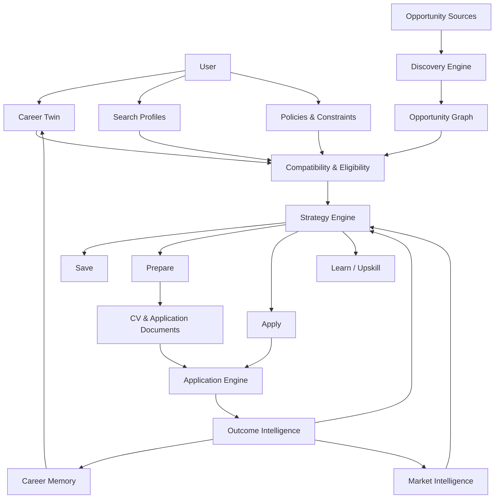

---

# 2. Product Vision

## 2.1 Problem

Opportunity search is fragmented across:

- job boards;
- company career pages;
- ATS platforms;
- university portals;
- government employment portals;
- email;
- calendars;
- CV versions;
- cover letters;
- application forms;
- interview notes;
- follow-up reminders;
- skills and learning platforms.

Most existing products optimize one isolated step.

Career Intelligence OS coordinates the entire lifecycle.

## 2.2 Product promise

> **Discover the right opportunities. Understand why they fit. Pursue them intelligently. Learn from every outcome.**

The platform must work for:

- students seeking flexible paid work;
- students seeking internships;
- apprentices and work-study candidates;
- graduates seeking their first professional role;
- professionals changing employers;
- professionals changing careers;
- users exploring geographic relocation;
- users planning skills development.

## 2.3 Non-goal

The goal is **not**:

```text
1,000 applications
       ↓
maximum volume
```

The desired funnel is:

```text
1,000 opportunities discovered
             ↓
        350 eligible
             ↓
      120 strong matches
             ↓
      35 high-value targets
             ↓
   20 strategic applications
             ↓
         7 interviews
             ↓
          2 offers
```

The system optimizes **quality-adjusted opportunity outcomes**, not raw submission count.

---

# 3. Product Vocabulary

## 3.1 Opportunity

`Opportunity` is the universal domain object.

```text
Opportunity
├── Student Job
├── Internship
├── Apprenticeship
├── Work-study / Alternance
├── Graduate Program
├── Temporary Work
├── Fixed-term Employment
├── Permanent Employment
└── Configurable future types
```

A `Job` is therefore an opportunity type, not the root model.

## 3.2 Career Intelligence

Career Intelligence is the system's ability to combine:

```text
Candidate
   +
Market
   +
Opportunities
   +
Constraints
   +
Historical Outcomes
   ↓
Recommendation / Decision
```

## 3.3 Career Twin

The Career Twin is the canonical, evidence-backed representation of the candidate.

## 3.4 Career Memory

Career Memory stores durable lessons from applications, interviews, feedback, outcomes, strategy experiments, and user decisions.

## 3.5 Opportunity Graph

The Opportunity Graph connects opportunities, companies, locations, requirements, skills, industries, candidate evidence, and outcomes.

---

# 4. User Lifecycle

Career Intelligence OS must support changing user states over time.

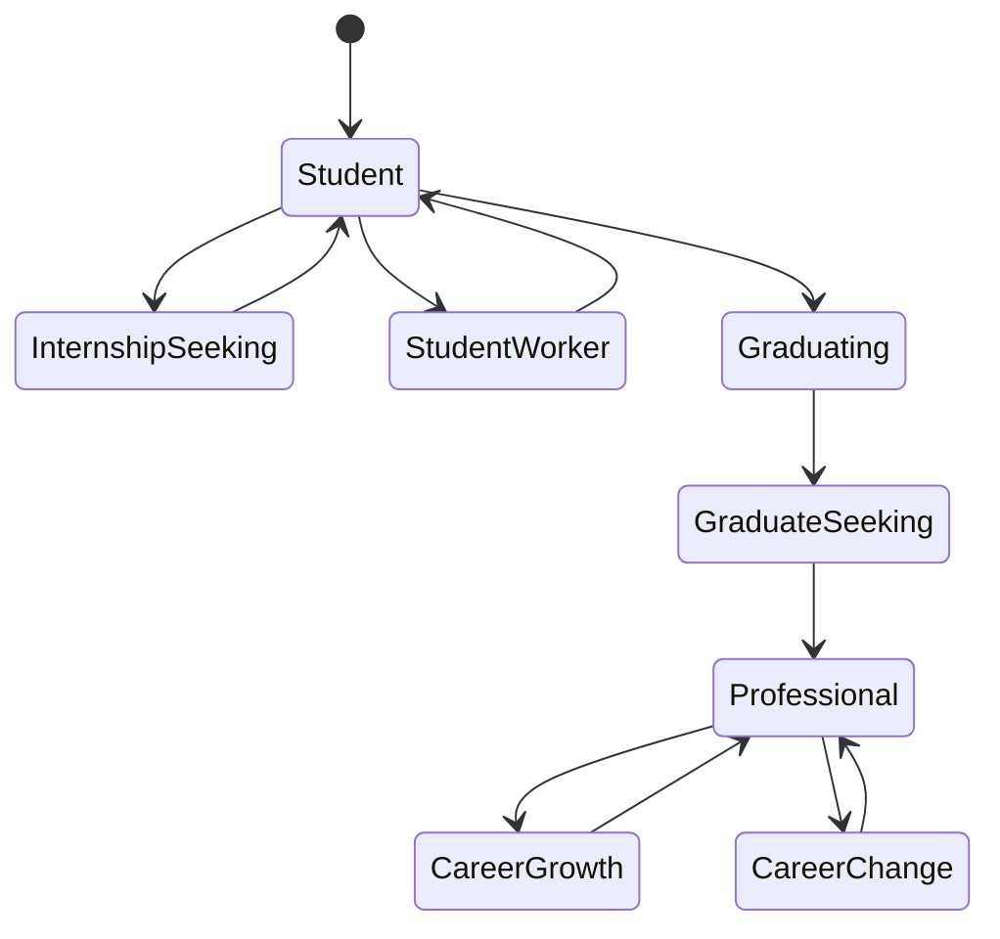

Example:

```text
STUDENT
├── Student jobs
├── Internships
├── Apprenticeships
└── Work-study
        ↓
GRADUATING
├── Graduate programs
├── Junior positions
└── Internships
        ↓
PROFESSIONAL
├── Permanent employment
├── Fixed-term employment
├── Temporary opportunities
└── Career progression
```

The platform must never assume that a user's current opportunity type remains constant forever.

---

# 5. Smart Onboarding

Onboarding should be conversational and progressive.

## 5.1 Information collected

### Identity and location
- residence country;
- city / search centers;
- target countries;
- relocation willingness;
- commuting limits;
- remote/hybrid/on-site preferences.

### Opportunity intent
- opportunity types;
- target roles;
- industries;
- seniority;
- desired start date;
- contract preferences.

### Student-specific context
- institution;
- study program;
- semester/year;
- weekly availability;
- academic calendar where provided;
- maximum work hours;
- internship/work-study constraints.

### Professional context
- work experience;
- responsibilities;
- projects;
- achievements;
- salary expectations;
- notice period.

### Eligibility
- work authorization;
- residence/work permits;
- language constraints;
- age or program restrictions where legally relevant;
- required enrollment status.

### Evidence
- CV;
- portfolio;
- GitHub/GitLab;
- LinkedIn;
- diplomas;
- certificates;
- references;
- project documents;
- manually supplied evidence.

## 5.2 Outputs

```text
Onboarding
   ↓
CandidateProfile
CareerTwin
SearchProfile[]
SearchPolicy
ApplicationPolicy
EligibilityContext
```

---

# 6. Candidate Career Twin

## 6.1 Purpose

The Career Twin is the source of truth used by matching, document generation, interview preparation, simulations, and career strategy.

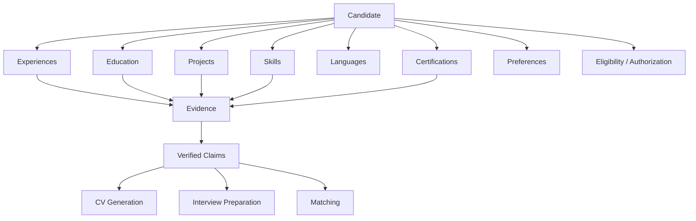

## 6.2 Evidence-backed claims

Every important generated claim should be traceable.

```yaml
claim:
  type: skill
  value: FastAPI
  confidence: 0.92
  evidence:
    - source: project
      reference: career-intelligence-backend
    - source: repository
      reference: github/project
  last_used: 2026
  verification: supported
```

The system must not fabricate:

- technologies;
- years of experience;
- employers;
- dates;
- qualifications;
- responsibilities;
- languages;
- numerical achievements;
- certifications.

## 6.3 EvidenceGuard

```text
LLM Draft
   ↓
Claim Extraction
   ↓
Evidence Lookup
   ↓
┌───────────────────────┐
│ Supported?            │
├───────────┬───────────┤
│ YES       │ NO        │
↓           ↓
Keep      Reject/Rewrite
└───────────┬───────────┘
            ↓
      Validated Artifact
```

---

# 7. Career Knowledge Graph

The V2+ Career Twin should evolve into a graph-oriented knowledge layer.

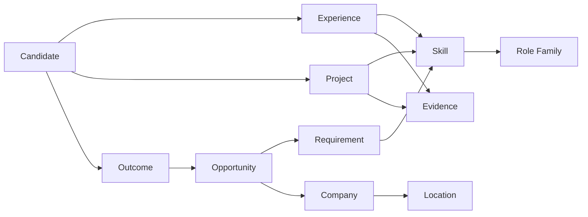

This enables queries such as:

- Which candidate skills have strong evidence but low market demand?
- Which missing skill unlocks the most compatible opportunities?
- Which projects prove requirements frequently found in target roles?
- Which companies repeatedly recruit profiles adjacent to the user's Career Twin?

---

# 8. Country Intelligence / Country Packs

Country-specific rules must not leak into core business logic.

```text
country_packs/
├── ch/
│   ├── metadata.yaml
│   ├── terminology.yaml
│   ├── opportunity_types.yaml
│   ├── sources.yaml
│   ├── eligibility.yaml
│   ├── salary.yaml
│   └── geography.yaml
├── fr/
├── de/
└── ...
```

A Country Pack may define:

- terminology;
- currencies;
- geographic hierarchy;
- opportunity types;
- source adapters;
- language conventions;
- employment metadata;
- eligibility rules;
- salary conventions;
- source capabilities and policies.

Core services consume typed Country Pack interfaces.

---

# 9. Opportunity Discovery

## 9.1 Sources

Supported source families may include:

- official/public APIs;
- ATS feeds;
- company career pages;
- university portals;
- public employment services;
- permitted job boards;
- partner feeds;
- email-imported opportunities;
- manually added opportunities.

## 9.2 Plugin contract

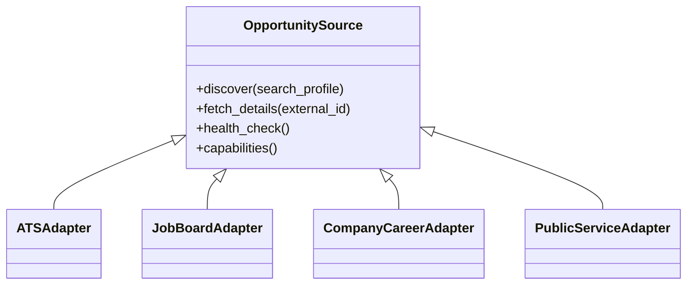

Each source advertises:

```yaml
capabilities:
  countries: [CH]
  discovery: true
  details: true
  application: false
  authentication_required: false
  rate_limit_strategy: polite
  policy_status: allowed
  health_status: healthy
```

## 9.3 Discovery pipeline


One source failure must not abort the full discovery run.

---

# 10. Company Intelligence

Companies are first-class entities.

```text
Company
├── Identity
├── Industry
├── Locations
├── Official website
├── Career sites
├── Detected ATS
├── Open opportunities
├── Hiring history
├── Candidate interactions
└── Verified research
```

Company discovery can:

1. discover organizations in a target area;
2. resolve official domains;
3. detect careers pages;
4. detect supported ATS providers;
5. fetch opportunities;
6. identify spontaneous-application channels;
7. maintain source confidence.

Company research used in generated documents must distinguish verified facts from model inference.

---

# 11. Opportunity Graph

Instead of treating listings as isolated rows:

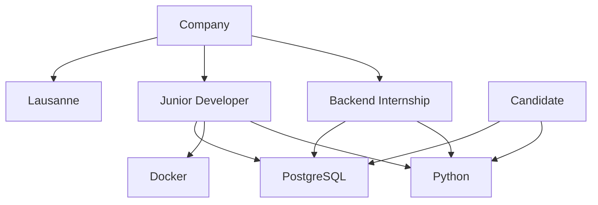

The graph supports market intelligence, skill-gap analysis, recommendation diversity, and career simulation.

---

# 12. Geographic Opportunity Explorer

The map is a primary product surface.

## 12.1 Example summary

```text
Yverdon
 ● 12 opportunities
 ████████░░ 82% compatibility

Lausanne
 ● 147 opportunities
 █████████░ 88% compatibility

Neuchâtel
 ● 43 opportunities
 ███████░░░ 74% compatibility

Genève
 ● 231 opportunities
 ██████░░░░ 67% compatibility
```

The displayed percentage is an aggregate indicator and must expose its calculation and confidence.

## 12.2 Filters

```text
Opportunity type
[x] Student job
[x] Internship
[ ] Work-study
[x] Professional

Location
Center: Lausanne
Radius: 50 km

Compatibility ≥ 70%
Eligibility: eligible only
Commute ≤ 60 min
Remote: allowed
Language: FR / EN
```

## 12.3 Map layers

- companies;
- open opportunities;
- saved opportunities;
- applications;
- interviews;
- spontaneous-application targets;
- compatibility heatmap;
- opportunity-density heatmap;
- skill-demand heatmap.

## 12.4 Geo architecture

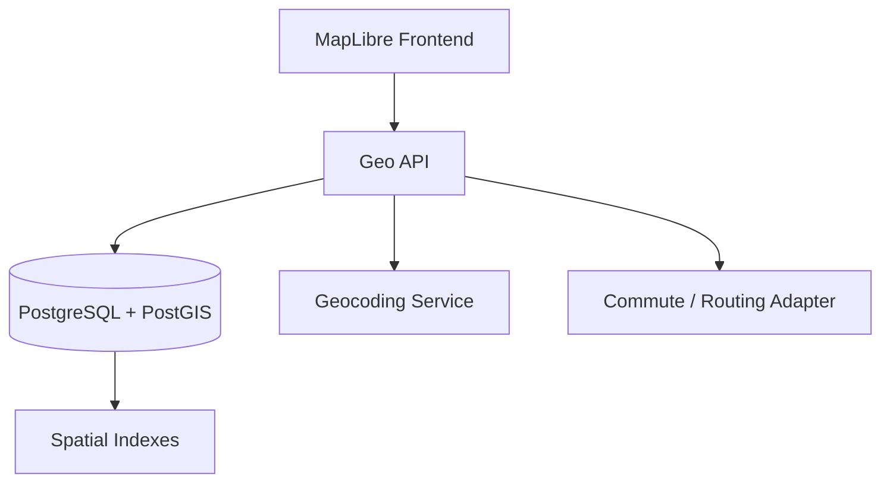

---

# 13. Eligibility Engine

Eligibility answers:

> **Can this user realistically and legally pursue this opportunity?**

It is separate from compatibility.

```text
Technical fit:     91%
Schedule fit:      42%
Language fit:      95%
Geographic fit:    80%

Eligibility:
❌ Required weekly availability conflicts with constraints

Overall recommendation:
REQUIRE_REVIEW
```

Hard failures and unknowns must never be hidden inside a weighted score.

Possible dimensions:

- work authorization;
- student enrollment;
- required degree;
- required language threshold;
- mandatory location;
- schedule;
- maximum working hours;
- start date;
- opportunity-specific legal/program rules.

---

# 14. Schedule Compatibility Engine

Especially important for student opportunities.

Inputs:

```text
Academic timetable
+ personal availability
+ work-hour limits
+ required shifts
+ workload %
+ commute duration
+ rest constraints
```

Example:

```text
Monday
08:00–17:00  Classes
18:00–20:00  Existing commitment
→ unavailable

Tuesday
08:00–16:00  Classes
17:30–22:00  available

Wednesday
No classes
→ highly available
```

The engine should distinguish known schedules from inferred or unspecified schedules.

---

# 15. Compatibility Engine

A single opaque score is insufficient.

## 15.1 Dimensions

- skills;
- experience;
- education;
- languages;
- schedule;
- geography;
- opportunity type;
- compensation;
- career relevance;
- evidence confidence.

Weights depend on opportunity type.

Illustrative configuration:

```text
Dimension          Student   Internship   Professional
------------------------------------------------------
Skills               15%        30%           40%
Experience             5%        10%           25%
Education              5%        20%            5%
Schedule              30%        10%            5%
Geography             20%        10%            5%
Language              15%        10%           10%
Career relevance       5%         5%            5%
Compensation           5%         5%            5%
```

Eligibility remains a separate gate.

## 15.2 Explainability

```text
Compatibility: 84%

Strong signals
+ Python requirement fully supported
+ PostgreSQL supported by 2 projects
+ French requirement satisfied
+ commute estimated within preference

Weak signals
- Docker evidence is limited
- preferred experience: 2 years
- candidate evidence confidence for CI/CD: medium

Eligibility
✓ Eligible

Recommendation
PREPARE
```

---

# 16. Opportunity Strategy Engine

The platform decides **what should happen next**.

Possible decisions:

```text
SKIP
SAVE
WATCH
PREPARE
REQUIRE_REVIEW
AUTO_APPLY
APPLY_AND_OUTREACH
SPONTANEOUS_APPLICATION
LEARN_FIRST
```

Decision inputs:

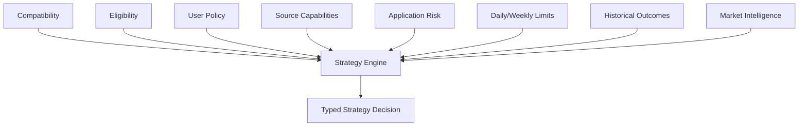

No LLM should directly perform an irreversible state mutation.

---

# 17. Application Material Engine

## 17.1 CV pipeline

```text
Career Twin
    ↓
Opportunity Analysis
    ↓
Relevant Evidence Selection
    ↓
Content Plan
    ↓
LLM Draft
    ↓
EvidenceGuard
    ↓
ATS Structural Validation
    ↓
Reviewer
    ↓
Revision
    ↓
PDF Render
    ↓
PDF / Text-layer Validation
    ↓
Version Registration
```

## 17.2 Drafter–Reviewer separation

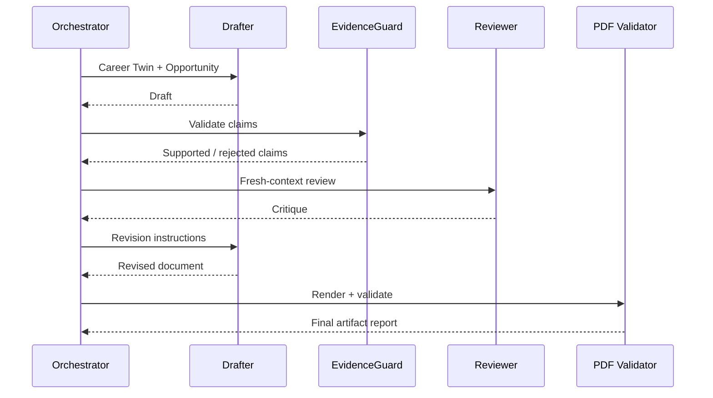

## 17.3 Cover letters

Generate only when useful or required.

They must be:

- opportunity-specific;
- company-specific only when facts are verified;
- evidence-grounded;
- concise;
- language-aware;
- versioned.

---

# 18. Application Engine

Channels:

- official API;
- ATS adapter;
- direct form;
- browser automation;
- email;
- manual-required;
- unsupported.

Playwright is an execution adapter, not the business brain.

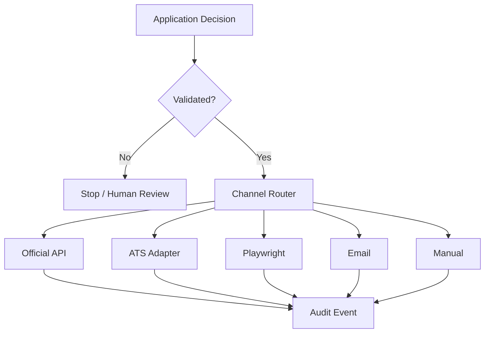

Every attempt records:

- timestamp;
- opportunity;
- artifacts;
- answers;
- adapter;
- status;
- screenshots when useful;
- error/failure reason;
- confirmation evidence.

CAPTCHA/MFA bypass and anti-bot evasion are non-goals.

---

# 19. Copilot and Autopilot

## Copilot

Prepares actions and asks for approval.

## Autopilot

Executes only actions explicitly permitted by policy.

Example policy:

```yaml
application_policy:
  mode: copilot
  auto_apply:
    enabled: true
    minimum_compatibility: 90
    eligibility_required: true
    allowed_opportunity_types:
      - student_job
      - internship
    max_per_day: 3
  require_review_when:
    - custom_questions
    - salary_question
    - missing_evidence
    - unsupported_adapter
```

---

# 20. AI Career Control Plane

Natural language is a control surface, not unrestricted database access.

Examples:

```text
"Show internships within 30 km with fit above 80%."

"Why was this opportunity rejected?"

"Generate another CV version."

"Stop professional-job applications this week."

"Prepare me for tomorrow's interview."

"What skill would unlock the most opportunities?"
```

Architecture:

```text
User request
    ↓
LLM interpretation
    ↓
Typed Command Proposal
    ↓
Authorization
    ↓
Validation
    ↓
Application Service
    ↓
Domain Operation
    ↓
Audit Event
```

---

# 21. Career Memory

Career Memory captures durable experience.

```text
CareerMemory
├── Application lessons
├── Interview questions
├── Interview weaknesses
├── Recruiter feedback
├── Rejection signals
├── Successful narratives
├── Strategy decisions
├── User preferences
└── Outcome patterns
```

Example:

```yaml
memory:
  event: interview
  opportunity: crew_member
  question: "How do you handle a rush?"
  evaluation:
    clarity: 0.84
    specificity: 0.61
  lesson:
    "Use a more concrete example and quantify the result."
```

Future preparation can retrieve relevant memories without treating them as immutable truth.

---

# 22. Outcome Tracking

Suggested lifecycle:

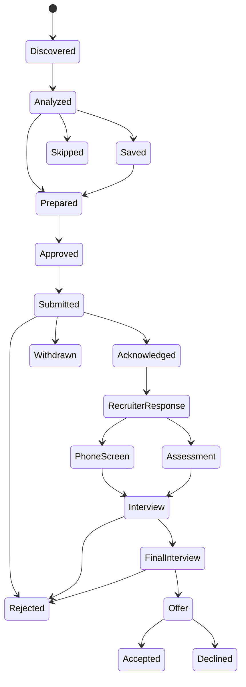

Every transition creates an immutable audit event.

---

# 23. Outcome Intelligence

The system measures:

- response rate;
- interview rate;
- offer rate;
- source performance;
- company performance;
- role-family performance;
- geographic performance;
- application timing;
- CV strategy;
- cover-letter strategy;
- compatibility calibration;
- skill-gap frequency.

Core metrics:

```text
Response Rate
= responses / submitted applications

Interview Conversion
= interviews / submitted applications

Offer Conversion
= offers / interviews

Acceptance Rate
= accepted offers / offers
```

Metrics require sufficient sample size and confidence indicators.

---

# 24. Application Experiment Engine

The platform can compare strategies without silently changing policy.

```text
EXPERIMENT: CV POSITIONING

Strategy A — Backend-focused CV
Applications: 38
Interviews:    7
Rate:          18.4%

Strategy B — General Software CV
Applications: 41
Interviews:    3
Rate:           7.3%

Observed uplift:
Strategy A ≈ 2.5× interview rate

Confidence:
LOW / MEDIUM / HIGH depending on sample quality
```

Experiments may cover:

- CV positioning;
- document length;
- application timing;
- opportunity family;
- source;
- outreach strategy;
- geographic strategy.

No causal claim should be made from weak observational data.

---

# 25. Market Intelligence

Aggregate discovered opportunities into a market view.

```text
TARGET MARKET — Backend / Software

Python
████████████████░░░░ 78%

Docker
████████████░░░░░░░░ 61%

AWS
███████████░░░░░░░░░ 53%

Kubernetes
███████░░░░░░░░░░░░░ 36%

FastAPI
██████░░░░░░░░░░░░░░ 31%
```

Compare with candidate evidence:

```text
SKILL GAP

AWS
Market demand:       53%
Candidate evidence:  Weak
Opportunity impact:  High
Priority:            HIGH
```

Market intelligence must preserve:

- sample size;
- time window;
- geography;
- opportunity types;
- source coverage;
- confidence.

---

# 26. Career / Opportunity GPS

The GPS answers:

> **What is the best path from my current state to my target opportunity?**

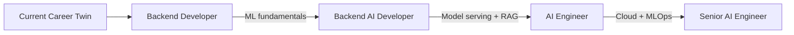

For students:

```text
Current state
Student
   ↓
Student job
   ↓ experience + income
Internship
   ↓ domain experience
Graduate / Junior role
   ↓
Professional trajectory
```

Recommendations should include cost, effort, evidence quality, opportunity gain, and uncertainty.

---

# 27. Career Simulation Engine

Users can ask counterfactual questions.

Example:

```text
Scenario:
"What if I learn Kubernetes?"

CURRENT
Compatible opportunities: 126
Average compatibility:     68%

SIMULATED
Compatible opportunities: 184
Average compatibility:     74%

Estimated unlocked:        +58
Confidence:                Medium
Market window:             last 90 days
Region:                    configured search market
```

Another simulation:

```text
Laravel vs Spring Boot

                         Laravel    Spring Boot
Current strong matches      126          72
Evidence strength           High         Medium
Learning gap                Low          Medium
Observed demand             Medium       High
Estimated time-to-proof     Short        Medium
Opportunity gain            +24          +63
```

Simulation outputs are decision support, not guarantees.

---

# 28. Career Strategist

The Strategist sits above operational agents.

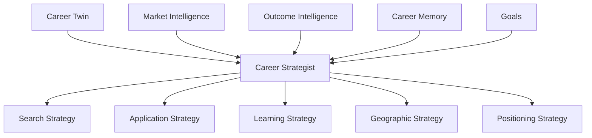

Example recommendation:

```text
Recommended allocation — next 30 days

45% Backend / Full-stack junior roles
25% Data / AI internships
20% Student technical jobs
10% exploratory opportunities

Reasoning:
- strongest evidence is currently backend;
- AI opportunities show a recurring ML/MLOps gap;
- student opportunities provide schedule-compatible income;
- internship conversion probability appears stronger than direct AI-engineer roles.
```

The user approves important strategy changes.

---

# 29. Interview Intelligence

Modes:

- recruiter/HR;
- behavioral;
- technical;
- hiring manager;
- case study;
- final interview.

Adaptive loop:

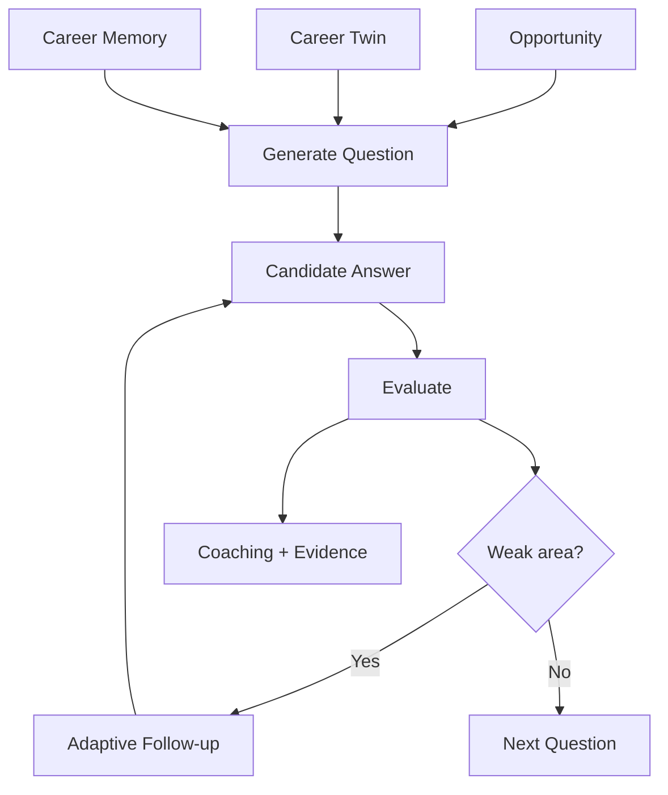

Possible evaluation dimensions:

- relevance;
- clarity;
- structure;
- specificity;
- evidence;
- technical correctness where applicable;
- STAR completeness;
- communication.

---

# 30. Notification and Communication Intelligence

Potential signals:

- application acknowledgement;
- recruiter reply;
- rejection;
- interview invitation;
- assessment invitation;
- offer;
- missing-document request;
- follow-up due.

Email/calendar integrations should produce **proposed typed events**, not silently rewrite application history when confidence is low.

---

# 31. High-Level System Architecture

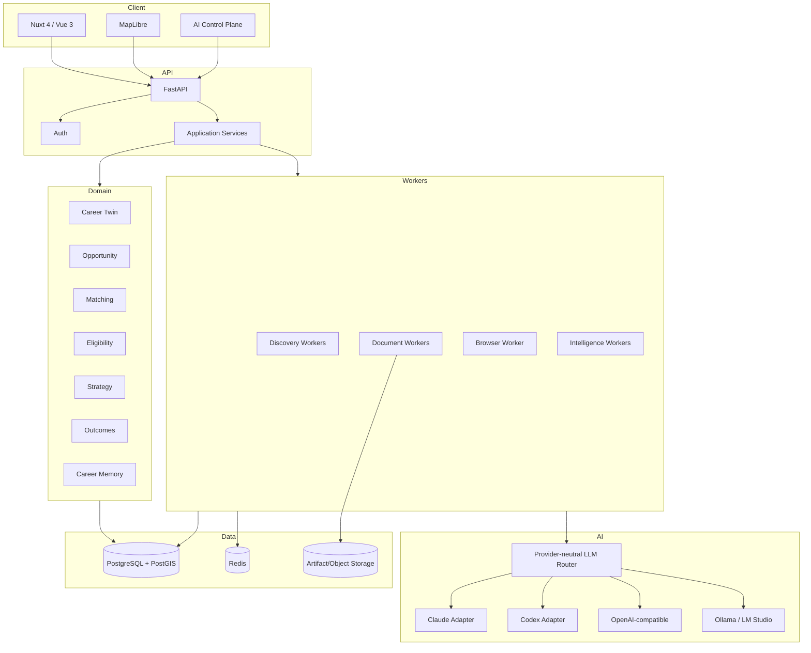

---

# 32. Recommended Backend Boundaries

```text
backend/app/
├── api/
├── application/
│   ├── commands/
│   ├── queries/
│   └── services/
├── domain/
│   ├── candidate/
│   ├── opportunity/
│   ├── company/
│   ├── matching/
│   ├── eligibility/
│   ├── strategy/
│   ├── application/
│   ├── interview/
│   ├── outcome/
│   ├── career_memory/
│   ├── market_intelligence/
│   └── simulation/
├── infrastructure/
│   ├── database/
│   ├── llm/
│   ├── browser/
│   ├── email/
│   ├── geo/
│   ├── sources/
│   └── storage/
├── workers/
├── repositories/
└── core/
```

Domain code must not import provider-specific LLM SDKs, Playwright internals, or web-framework details.

---

# 33. Provider-Neutral LLM Platform

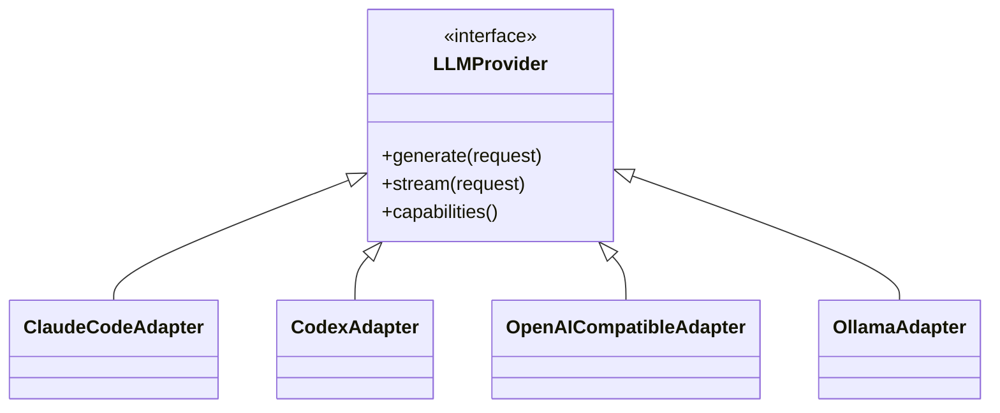

Typed request example:

```python
class LLMRequest:
    task: str
    context: list[ContextItem]
    response_schema: type
    temperature: float | None
    max_tokens: int | None
```

Provider-specific session IDs, CLI flags, base URLs, SDK calls, and authentication remain isolated.

---

# 34. Context Optimization Layer

Long tool outputs, source results, HTML, logs, and histories should pass through a context optimization layer.

```text
Raw context
   ↓
Classification
   ↓
Relevance filtering
   ↓
Compression / summarization
   ↓
Evidence pointers retained
   ↓
Token budget allocation
   ↓
LLM request
```

Track:

- raw tokens;
- compressed tokens;
- savings;
- dropped context;
- retained evidence references;
- compression strategy;
- reconstruction/reference path where appropriate.

---

# 35. Data Model — Core Entities

Suggested conceptual entities:

```text
User
CandidateProfile
CareerTwin
CareerClaim
Evidence
Experience
Education
Project
Skill
Language
Certification

SearchProfile
SearchPolicy
ApplicationPolicy

Opportunity
OpportunityRequirement
OpportunityLocation
OpportunitySourceRecord

Company
CompanyLocation
CareerSite
DetectedATS

CompatibilityAssessment
EligibilityAssessment
StrategyDecision

Application
ApplicationArtifact
ApplicationAnswer
ApplicationAttempt
AuditEvent

Interview
InterviewSession
InterviewQuestion
InterviewEvaluation

CareerMemory
Outcome
OutcomeSignal

MarketSkill
MarketObservation
MarketTrend

CareerGoal
CareerPath
CareerGap
CareerSimulation
SimulationScenario
SimulationResult

StrategyExperiment
ExperimentVariant
StrategyRecommendation
```

---

# 36. Auditability

Important decisions must be explainable after the fact.

```text
AuditEvent
├── actor
├── timestamp
├── action
├── entity
├── previous state
├── new state
├── reason
├── policy
├── provider/tool
├── correlation id
└── evidence references
```

Irreversible actions require validated application services.

---

# 37. Security & Privacy

V2 multi-user requirements:

- strong authentication;
- user-scoped data isolation;
- encrypted secrets;
- encrypted sensitive credentials;
- least-privilege integrations;
- immutable audit logs where appropriate;
- rate limiting;
- secure file handling;
- GDPR-aware export/deletion;
- retention policies;
- explicit integration consent;
- secret scanning;
- no personal candidate data in public repositories.

Sensitive application data must never be embedded into Country Packs or source plugins.

---

# 38. SaaS Model

Potential plan dimensions:

```text
FREE
├── limited searches
├── manual applications
└── basic matching

PLUS
├── larger discovery quota
├── document generation
├── interview intelligence
└── advanced analytics

PRO
├── autonomous agents
├── simulations
├── Career Strategist
├── advanced market intelligence
└── higher automation limits
```

Exact packaging should be validated commercially rather than hard-coded into the domain.

---

# 39. Observability

Track:

- discovery success rate;
- source health;
- normalization failures;
- duplicate rate;
- geocoding success;
- LLM latency/cost;
- tokens saved by compression;
- document validation failures;
- application adapter success;
- browser failure reasons;
- queue depth;
- outcome ingestion confidence.

```text
Source Health

jobs_source_a      ██████████ 99%
ats_adapter_b      █████████░ 94%
career_pages       ████████░░ 83%
source_c           ████░░░░░░ 41% ⚠
```

---

# 40. Quality Gates

Backend:

- pytest;
- Ruff;
- strict mypy;
- migration checks;
- domain tests;
- repository integration tests.

Frontend:

- Vitest;
- TypeScript checks;
- component tests;
- Playwright E2E.

AI:

- structured-output validation;
- hallucination/evidence tests;
- prompt regression suites;
- provider parity tests;
- deterministic guard tests.

Application automation:

- sandbox/test forms;
- replayable fixtures;
- screenshot evidence;
- idempotency tests;
- duplicate-submission prevention.

---

# 41. Key Product Metrics

## North-star candidate metric

A useful long-term metric is:

```text
Qualified Opportunity Outcome Rate
=
meaningful positive outcomes
────────────────────────────
strategic applications
```

Supporting metrics:

```text
Discovery → Eligible
Eligible → Strong Match
Strong Match → Prepared
Prepared → Submitted
Submitted → Response
Response → Interview
Interview → Offer
Offer → Accepted
```

The platform should optimize meaningful outcomes without manipulating users into unnecessary application volume.

---

# 42. Implementation Roadmap

## Phase 0 — V1 preservation
- inventory working V1 behavior;
- regression tests;
- compatibility boundary.

## Phase 1 — Engineering foundation
- CI;
- Ruff;
- mypy;
- test gates;
- architecture rules.

## Phase 2 — Opportunity domain
- universal `Opportunity`;
- opportunity types;
- domain events;
- repository contracts.

## Phase 3 — PostgreSQL/PostGIS
- SQLAlchemy 2;
- Alembic;
- spatial models;
- Docker infrastructure.

## Phase 4 — Multi-user foundation
- authentication;
- tenant/user isolation;
- onboarding.

## Phase 5 — Career Twin + EvidenceGuard
- canonical profile;
- claims;
- evidence;
- deterministic validation.

## Phase 6 — Country Packs
- CH reference pack;
- plugin contracts;
- country terminology and eligibility.

## Phase 7 — Discovery & Company Intelligence
- source registry;
- company discovery;
- ATS detection;
- source health.

## Phase 8 — Geo Opportunity Explorer
- PostGIS queries;
- map;
- radius;
- clustering;
- commute adapters.

## Phase 9 — Eligibility + Compatibility V2
- hard eligibility;
- opportunity-type scoring strategies;
- explanations;
- confidence.

## Phase 10 — Document Intelligence
- ATS CV;
- cover letter;
- reviewer;
- evidence guard;
- artifact history.

## Phase 11 — Provider-neutral AI
- LLM router;
- Claude;
- Codex;
- OpenAI-compatible;
- local models;
- context optimization.

## Phase 12 — Application Strategy + Engine
- typed decisions;
- policy;
- adapters;
- Copilot;
- Autopilot.

## Phase 13 — Outcome + Career Memory
- lifecycle;
- email/calendar signals;
- immutable events;
- memory.

## Phase 14 — Market Intelligence
- skill demand;
- geography;
- source analytics;
- trend confidence.

## Phase 15 — Career GPS + Simulation
- goals;
- gaps;
- scenario engine;
- opportunity-gain estimation.

## Phase 16 — Strategy Experiments
- variants;
- metrics;
- confidence;
- recommendations.

## Phase 17 — Career Strategist
- strategy synthesis;
- search allocation;
- learning recommendations;
- positioning recommendations.

## Phase 18 — Adaptive Interview Intelligence
- simulation;
- voice-ready interfaces;
- follow-ups;
- longitudinal readiness.

## Phase 19 — SaaS hardening
- subscriptions;
- quotas;
- GDPR lifecycle;
- security;
- observability;
- country expansion.

Each phase must have acceptance criteria and cannot be considered complete solely because code exists.

---

# 43. Distinctive Product Moat

The product should not compete on:

```text
"AI writes your CV"
"AI applies to 500 jobs"
"AI scrapes job boards"
```

Those are features.

The defensible system is the closed intelligence loop:

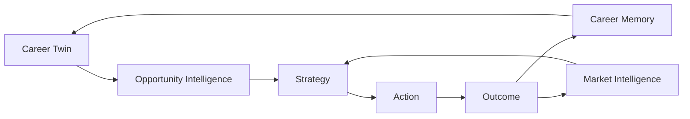

The strongest differentiators are:

**Opportunity-first domain + evidence-backed Career Twin + Country Intelligence + geospatial opportunity intelligence + eligibility-aware matching + Career Memory + outcome learning + Market Intelligence + Career GPS + career simulation + strategy experimentation.**

---

# 44. Example User Journey — Student

```text
User:
"I'm studying and need work compatible with my timetable."

System:
1. Reads Search Profile
2. Reads availability
3. Applies work-hour constraints
4. Discovers student opportunities
5. Computes commute
6. Checks eligibility
7. Scores schedule compatibility
8. Ranks opportunities
9. Prepares approved applications
10. Tracks responses
```

Result:

```text
TOP OPPORTUNITIES

1. Student IT Support
   Lausanne
   Compatibility  91%
   Schedule       96%
   Eligibility     ✓
   Commute        38 min
   Decision       PREPARE

2. Evening Crew
   Yverdon
   Compatibility  84%
   Schedule       94%
   Eligibility     ✓
   Commute        14 min
   Decision       PREPARE

3. Junior Developer 60%
   Lausanne
   Compatibility  88%
   Schedule       31%
   Eligibility     ✓
   Decision       SAVE
```

The technically strongest role is not automatically the best opportunity.

---

# 45. Example User Journey — Internship

```text
Goal:
Find a 6-month software/data internship.

System considers:
├── studies
├── projects
├── technical evidence
├── internship dates
├── languages
├── location
├── company relevance
└── future career goal
```

It can recommend an internship with slightly lower immediate skill fit if its trajectory value is significantly higher.

---

# 46. Example User Journey — Professional

```text
Goal:
Move from backend development toward AI engineering.

Career GPS:

Backend Developer
      │
      ├── strong: APIs
      ├── strong: databases
      ├── strong: Python
      ├── medium: Docker
      ├── medium: RAG
      ├── weak: ML production
      └── weak: MLOps
             ↓
Recommended bridge:
Backend AI / Applied AI role
             ↓
AI Engineer
```

The platform searches both immediate opportunities and strategically useful bridge opportunities.

---

# 47. Design Principles

1. **Opportunity-first** — never reduce the product to full-time jobs.
2. **Truth before persuasion** — generated content must remain evidence-backed.
3. **Eligibility before ranking** — impossible opportunities must be clearly identified.
4. **Explainability over magic scores**.
5. **Strategy over volume**.
6. **Human authority over irreversible actions**.
7. **Provider neutrality**.
8. **Country intelligence through plugins/configuration**.
9. **Outcomes improve recommendations, not hidden policy**.
10. **Uncertainty must be visible**.
11. **Longitudinal value** — the system should become more useful over years.
12. **Privacy by architecture**.
13. **Agents propose; application services validate and execute**.
14. **Maps provide intelligence, not decoration**.
15. **The candidate owns their Career Twin and history**.

---

# 48. Product Identity

## Working technical name

`job-search-pipeline`

## Product category

**Career Intelligence OS**

## Suggested positioning

> **Career Intelligence OS discovers, evaluates, and helps pursue the right opportunities — from student jobs and internships to professional careers — while learning from outcomes to improve the user's long-term strategy.**

## Short tagline

> **Don't just search for opportunities. Engineer your trajectory.**

Alternative:

> **From student opportunities to professional careers — one intelligent system.**

---

# 49. Definition of Success

Career Intelligence OS succeeds when a user can start with:

> "I need a student job that fits around my classes."

Later ask:

> "Find my next internship."

Then:

> "I'm graduating. Which junior roles give me the best trajectory?"

And years later:

> "What is the most realistic path from my current profile to AI Engineer?"

—all while using the same evidence-backed Career Twin, Career Memory, opportunity history, market intelligence, and strategy engine.

That continuity is the product.

---

# 50. Final Architecture Principle

```text
                         USER
                          │
                          ▼
                    CAREER TWIN
                          │
             ┌────────────┼────────────┐
             ▼            ▼            ▼
        Constraints     Goals       Evidence
             │            │            │
             └────────────┼────────────┘
                          ▼
                OPPORTUNITY INTELLIGENCE
                          │
        ┌─────────────────┼─────────────────┐
        ▼                 ▼                 ▼
     Discovery       Market Graph       Geo Engine
        │                 │                 │
        └─────────────────┼─────────────────┘
                          ▼
              ELIGIBILITY + MATCHING
                          │
                          ▼
                   STRATEGY ENGINE
                          │
             ┌────────────┼────────────┐
             ▼            ▼            ▼
          Apply         Learn       Simulate
             │            │            │
             ▼            ▼            ▼
        Interviews    Career GPS   Future Paths
             │            │            │
             └────────────┼────────────┘
                          ▼
                       OUTCOMES
                          │
             ┌────────────┴────────────┐
             ▼                         ▼
       CAREER MEMORY             MARKET LEARNING
             │                         │
             └────────────┬────────────┘
                          ▼
                   BETTER STRATEGY
                          │
                          └──────────────► continuous loop
```

**Career Intelligence OS is therefore not a job application bot. It is a longitudinal opportunity and career decision system.**
